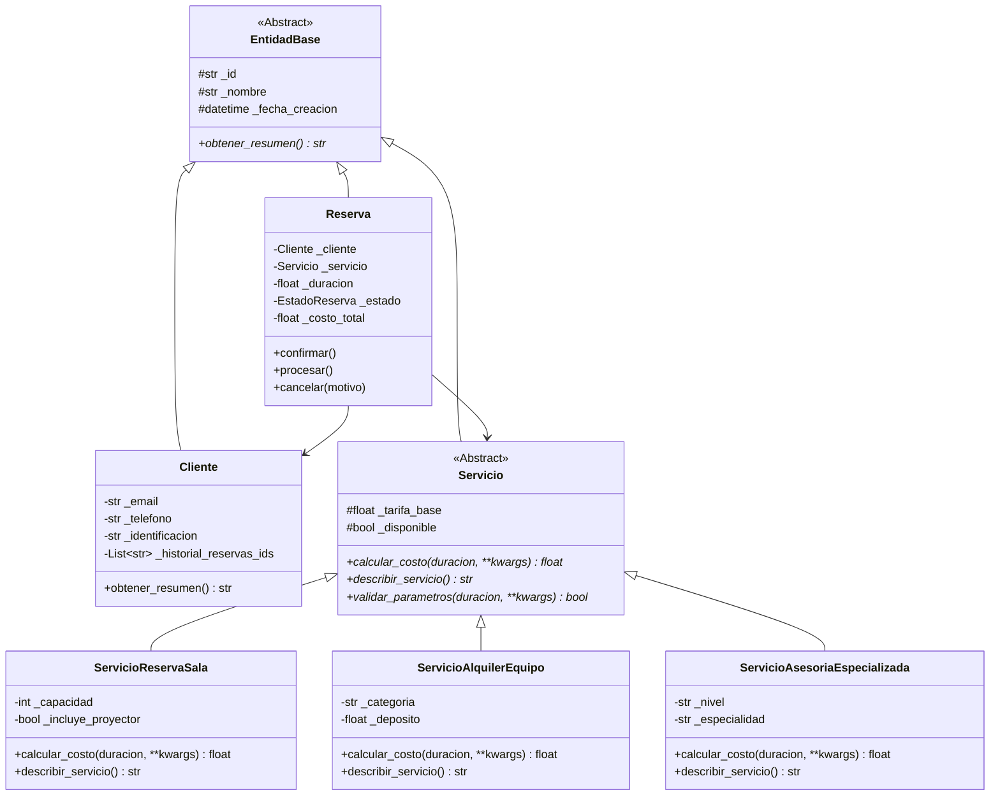

# 🚀 Sistema de Gestión Orientado a Objetos - Software FJ

Sistema integral de gestión de **clientes, servicios y reservas** desarrollado para la empresa **Software FJ**, especializada en la oferta de reservas de salas, alquiler de equipos tecnológicos y asesorías especializadas.

Este proyecto fue diseñado bajo una sólida arquitectura **Orientada a Objetos (POO)** en Python, implementando de forma rigurosa principios de **abstracción, herencia, polimorfismo, encapsulación estricta y manejo avanzado de excepciones** (incluyendo excepciones personalizadas, encadenamiento de errores y registro persistente de logs). El sistema garantiza tolerancia a fallos, continuando su ejecución normal sin caídas aun cuando se presenten datos o transacciones no válidas.

---

## 📐 Arquitectura del Sistema y Principios POO



### 🔑 Aspectos Clave del Diseño
1. **Abstracción (`EntidadBase`, `Servicio`)**: Define contratos claros con métodos abstractos (`@abstractmethod`) para forzar a las clases hijas a implementar la lógica requerida.
2. **Encapsulación Estricta (`Cliente`)**: Atributos con prefijo `_` accesibles únicamente mediante `@property` y `@setter` respaldados por expresiones regulares (`re`) para correos y teléfonos.
3. **Polimorfismo (`ServicioReservaSala`, `ServicioAlquilerEquipo`, `ServicioAsesoriaEspecializada`)**: Cada subclase implementa de manera única la lógica de `calcular_costo()`, `describir_servicio()` y `validar_parametros()`.
4. **Sobrecarga de Métodos Flexibles**: Simulada en Python mediante parámetros descompuestos (`**kwargs`), permitiendo calcular tarifas con impuestos, catering opcional, seguros de hardware, niveles de consultoría y descuentos por volumen o duración.

---

## 🛡️ Jerarquía de Excepciones y Sistema de Logs

La aplicación utiliza un sistema jerárquico de excepciones customizadas que heredan de `SoftwareFJError`:

- `SoftwareFJError` (Base)
  - ├── `ClienteInvalidoError` (Formato de correo, teléfono o ID nulo/inválido)
  - ├── `ServicioNoDisponibleError` (Servicios inactivos o no encontrados)
  - ├── `ReservaInvalidaError` (Duraciones o asistentes fuera de norma)
  - ├── `ParametroFaltanteError` (Argumentos requeridos ausentes)
  - ├── `CalculoInconsistenteError` (Tarifas negativas o descuentos mal delimitados)
  - └── `OperacionNoPermitidaError` (Transiciones de estado ilegales o cancelación no permitida)

Todas las excepciones capturadas y eventos clave se escriben automáticamente en el archivo **`software_fj.log`** mediante el módulo `logging`, manteniendo la aplicación activa en todo momento.

---

## 📁 Estructura del Repositorio

```text
SoftwareFJ-POO/
├── README.md                 # Documentación principal del proyecto
├── .gitignore                # Archivos ignorados por Git (entornos, logs, temporales)
├── requirements.txt          # Requisitos del proyecto (Librerías estándar de Python 3.10+)
├── software_fj_system.py     # Código fuente completo con clases y simulación interactiva
└── software_fj.log           # Log generado durante las pruebas de simulación
```

---

## ⚙️ Instalación y Ejecución

### Prerrequisitos
- Python 3.10 o superior instalado.
- Ninguna librería de terceros requerida (utiliza librerías nativas de la Standard Library de Python).

### 🚀 Pasos para ejecutar localmente

1. **Clonar el repositorio:**
   ```bash
   git clone <URL_DE_TU_REPOSITORIO>
   cd SoftwareFJ-POO
   ```

2. **Ejecutar el programa principal:**
   ```bash
   python3 software_fj_system.py
   ```

3. **Inspeccionar el registro de logs:**
   ```bash
   cat software_fj.log
   ```

---

## 🧪 Resumen de la Simulación de Pruebas

El script ejecuta automáticamente **10 operaciones simuladas** que ponen a prueba la resiliencia del sistema:

| Operación | Descripción | Resultado |
|---|---|---|
| **Op 1** | Registro de cliente válido | ✅ Éxito (Cliente registrado) |
| **Op 2** | Registro con correo sin @ | 🛡️ Excepción capturada (ClienteInvalidoError) |
| **Op 3** | Creación de servicio de Sala VIP | ✅ Éxito (Catálogo actualizado) |
| **Op 4** | Creación de servicio con tarifa -$10/hr | 🛡️ Excepción capturada (CalculoInconsistenteError) |
| **Op 5** | Creación de Servicios de Hardware y Asesoría Senior | ✅ Éxito (Catálogo actualizado) |
| **Op 6** | Creación y confirmación de reserva con catering | ✅ Éxito (Reserva CONFIRMADA) |
| **Op 7** | Reserva de sala por 100 horas continuas | 🛡️ Excepción capturada (ReservaInvalidaError) |
| **Op 8** | Reserva de equipo estando desactivado | 🛡️ Excepción capturada (ServicioNoDisponibleError) |
| **Op 9** | Flujo completo try/except/else/finally | 🎉 Éxito (Reserva PROCESADA) |
| **Op 9.1**| Intento ilegal de cancelar reserva ya procesada | 🛡️ Excepción con encadenamiento (raise from) |
| **Op 10**| Asesoría Urgente >20 hrs con cálculo complejo | ✅ Éxito (Reserva completada) |

---

## 📤 Cómo publicar este proyecto en GitHub

Si deseas subir este proyecto a tu propia cuenta de GitHub, ejecuta los siguientes comandos desde tu terminal local:

```bash
# 1. Inicializar el repositorio Git (si no está inicializado)
git init

# 2. Agregar todos los archivos al staging area
git add .

# 3. Realizar el primer commit
git commit -m "feat: Implementación inicial del sistema POO para Software FJ"

# 4. Cambiar el nombre de la rama principal a main
git branch -M main

# 5. Conectar con tu repositorio remoto de GitHub (reemplaza con tu URL)
git remote add origin <URL_DE_TU_REPOSITORIO_EN_GITHUB>

# 6. Subir los cambios a GitHub
git push -u origin main
```

---
*Desarrollado para **Software FJ** - Arquitectura Orientada a Objetos en Python.*
